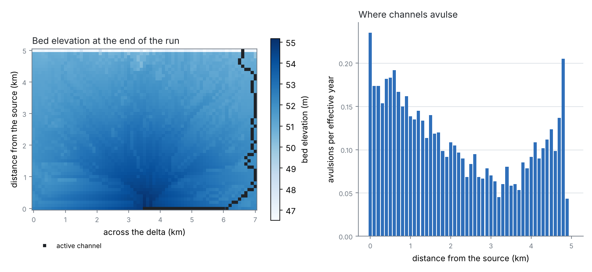

<p align="center">
  
</p>

# River delta model: surface processes and stratigraphy

A computational research model of river-delta evolution, channel avulsions, sediment transport, and three-dimensional stratigraphy. This repository supports **a new study in preparation** investigating how delta geometry and boundary conditions influence channel dynamics, and how channel processes are reflected in stratigraphic patterns. The new work is distinct from the earlier preprint.

Water and sediment enter a cellular delta plain at a single source. Channels aggrade, levees build, and avulsions establish new pathways across the delta. Backwater effects influence the flow, while the model records sediment deposits and their ages in three dimensions. New simulations compare rectangular and semicircular domains and explore channel residence time, avulsion patterns, boundary effects, and stratigraphic signatures.

The repository contains three main components:

- `src/deltamodel/`: a tested Python implementation of the model, extended to support a semicircular domain with an open shoreline.
- `paper/`: simulations, analysis, and figures for the **new research study**, including work on the statistical signatures of delta channels.
- `fortran/`: the historical Fortran implementation, corrected and retained for reproducibility and validation.

**Historical background:** The model grew out of research initiated in 2006–2007, associated with Puma et al., [*On the connections between surficial processes and stratigraphy in river deltas*](https://arxiv.org/abs/1606.04558) (2016). That preprint remains a separate historical publication and is not being revised as part of this project.



*A 710-effective-year run (`examples/plot_delta.py`). Left: the bed after the run, with the active channel. Right: avulsions after the 110-year spin-up, by distance from the source.*

## Python package

```sh
pip install -e .            # needs numpy and numba; add [test] for pytest, [examples] for matplotlib
```

```python
from deltamodel import Params, run

p = Params(tmax=100.0, teq=20.0)       # defaults are the 2007 run parameters (tmax=710, teq=110)
res = run(p, seed=1)
print(res.num_avulsions)
res.eta, res.levee, res.channel        # bed and levee elevation, final channel
res.avulsions                          # time, x and y of each avulsion
res.visit_mean, res.return_mean        # channel residence time and time between visits, per cell
res.strat_thickness, res.strat_type, res.strat_time   # 3-D stratigraphy
```

### Domain

`Params(domain="rectangle")` (the default) is the 2007 domain: a 5 km × 7 km plain with no-flow side walls and a straight shoreline. The side walls influence channel occupancy, motivating comparisons of boundary effects in the new work. `Params(domain="semicircle", ymax=R)` gives a delta plain of radius `R` cells around a source on the straight landward edge; the channel ends wherever it reaches the shoreline ring, so no boundary steers it. Set `Qs` in proportion to the area of the plain to keep the supply per unit area the same, and start from `initial_bed(p, seed=...)`, which slopes radially.

```python
import numpy as np
from deltamodel import Params, run, initial_bed

R = 50
p = Params(domain="semicircle", ymax=R, Qs=0.0025 / (50 * 71) * np.pi * R**2 / 2)
res = run(p, eta0=initial_bed(p, seed=1), seed=1)
res.land, res.shoreline                 # masks of the plain and of the shoreline cells
```

`deltamodel.history` rebuilds the channel path after every avulsion, and from it every channel visit to every cell. `run(..., stratigraphy=False)` skips the stratigraphy record, which does not affect the bed, to save memory on large domains. A 710-year run takes about five minutes on one core.

`python -m pytest tests` runs the checks (about 40 seconds): the Python model against a stored run of `fortran/`, the mass balance of the stratigraphy, the channel history, and the semicircular domain.

## Fortran program

```sh
sh fortran/build.sh                    # gfortran
mkdir run && cd run && ../fortran/delta
```

A run covers 710 effective years with a maximum time step of 0.0001 effective years and takes about six minutes on one core. The program writes about 50 text files to the working directory, among them:

| File | Contents |
|---|---|
| `etaout.txt`, `levout.txt` | Bed and levee elevation on the grid, every effective year |
| `Hout.txt`, `Havg.txt` | Flow depth, and its time average |
| `Qsout.txt` | Sediment flux |
| `avul_out.txt` | Avulsions: time and position |
| `visit*.txt`, `visitnum*.txt`, `Tv_series*.txt` | Channel visit durations, counts and times between visits |
| `strat{2,5,10,20,25,30,40,50}.txt`, `sedtyp*.txt`, `sedtim*.txt` | Stratigraphy of cross-sections at grid positions j = 2 to 50: deposit thickness, sediment type and deposition time |

With `i_etaflag = 1` the program reads the initial bed from `eta_init.txt` instead of drawing it at random.

## Validation

`fortran/` and the Python package were compared on the same initial bed (`tests/data/eta_init.txt.gz`):

- **30-year run** (stored in `tests/data/`, checked by the tests): the same 134 avulsions at the same times and places; bed, levee, stratigraphy layer counts, channel deposit thickness and mean residence time identical to the last bit.
- **710-year run** (bounds-checked Fortran build): the same 3,801 avulsions; bed, levee, layer counts, channel deposit thickness and mean residence time identical to the last bit.

Every column's stratigraphy adds up to the bed elevation plus the subsidence applied (14.2 m over 710 years) to within 2 × 10⁻⁸ m.

## Technical history: corrections made in 2026

The Python translation was first checked line by line against the 2007 program, which it reproduced exactly. That comparison turned up the following errors, corrected in both versions. Each is marked `Correction N (2026)` in `fortran/` and `_fix N` in `src/deltamodel/_kernel.py`.

1. **Sediment flux when the bed is held at zero.** When erosion would take a cell below zero elevation, the flux passed downstream is recomputed from the Exner equation, but the inversion omitted the factor 1/(1 − 2 a_u). With full upwinding (a_u = 1) the flux had the wrong sign.
2. **Slope of flat reaches of a new channel.** A reach that would be flat or reversed is given the slope `S_incise`, but the bed drop used the cell length of a direction left over from another step, not of the step being made.
3. **Length in the avulsion criterion.** The criterion compares the slope to the lowest free neighbour with the slope along the channel. The channel slope used the length to whichever active neighbour `slope5` found last, which need not be the next channel cell (a diagonal step has length √2·a).
4. **Stratigraphy at the end of the run.** Deposition since the last avulsion was never added, and the summary of channel and overbank deposits looped over as many layers as there were avulsions rather than the layers each column has.
5. **Initial incision recorded as deposition.** After the first channel was cut into the bed, the reference elevation for the next stratigraphy update was not reset, so the cut was later recorded as negative deposition.
6. **Backwater corrector.** The predictor–corrector for flow depth used the friction coefficient from the old depth in the corrector step instead of the predicted depth.
7. **Channel cells with no free neighbour.** When all five neighbours of a channel cell are already channel or outside the grid, `maxloc` still returns a direction. The avulsion test then used that blocked cell (outside the array at the edge of the grid), and a new channel path would step into it. The program no longer tests for an avulsion from such a cell, and a new path continues straight downstream.
8. **Erosion below the initial deposit.** When erosion removed every layer above the initial deposit, the remainder was dropped, so the stratigraphic column no longer added up to the bed elevation.
9. **Channel incision after an avulsion.** Cutting the new channel removed a full channel depth from the stratigraphy instead of the thickness actually cut.

Corrections 4, 5, 8 and 9 concern only the record of the stratigraphy, not the evolution of the bed; before them, the top of a stratigraphic column could differ from the bed by several metres.

Also changed, without effect on the results:

- All constants are double precision; several were written as single-precision literals (`0.0001`, `0.4`, …).
- The two routines specific to the Silverfrost FTN95 compiler (`date_time_seed@`, `random()`) are replaced by standard Fortran (`random_seed`, `random_number`).
- `bed_elev.f95` used unit 12, which is also `levout.txt`.
- The scour check no longer reads `eta_act(0)`, and a reset loop cleared the wrong array element.
- The visit-time series hold 100 visits per cell and could be written past their end; later visits are still counted but not stored. The stratigraphy output now writes every layer.

## New research study: boundary effects and delta dynamics

`paper/` runs experiments, analyzes channel and stratigraphic behavior, and generates figures for the new manuscript in preparation:

```sh
python paper/run_paper.py               # semicircles of radius 5 and 10 km, and the 5 x 7 and 10 x 14 km rectangles
python paper/figures.py                 # Figures 2-12, and every number quoted in the text in paper/figures/results.json
```

The 5 km runs take 5–10 minutes each and the 10 km runs about an hour; together they need about 2 GB of disk. `paper/analysis.py` computes the statistics: channel residence time, the effect of the side walls, the compensation index of Straub et al. (2009), the reworking and channel-overlap time scales of Wickert et al. (2013), and the Hack-like scaling of distributary networks of Dong et al. (2026).

## Related analysis: what delta channel statistics record

`paper/signatures/` compares the model with null models to ask which statistical signatures of delta channels record how new channels are routed (topographic steering), which follow from where avulsions occur, and which from geometry alone:

```sh
python paper/signatures/run_robustness.py                     # other initial beds, avulsion thresholds, floodplain rates
python paper/signatures/null_model.py RUN.pkl OUT.pkl [seed] [uniform]   # random-walk nulls from a model run
python paper/signatures/figures.py                            # figures and results.json in paper/signatures/figures/
```

`paper/signatures/real_deltas.py` repeats the test on nine river-dominated deltas: it builds each delta's outline from its mapped channel network and shoreline, grows random networks inside it, and compares their Hack-like scaling with the real network's. It needs the DIDNT dataset (Hariharan et al. 2022) and the supplementary data of Dong et al. (2026), which are not included here; see the module's docstring. `real_deltas.py --extra OUT.json` adds random trees directed straight out from the apex and trees grown in a Laplace field that the network screens (one channel at a time, starting where the flux out of the network is strongest), and `real_deltas.py --spread OUT.json` measures how evenly the channels of each kind of network fill the outline. `short_figures.py` makes the figures of the short paper from these outputs.

The null models keep the model's avulsion times but send each new channel along a directed random walk to the shoreline, either from the model's avulsion sites or from sites chosen uniformly along the channel. `paper/signatures/metrics.py` computes the statistics: the residence-time exponent, Hack-like scaling (Dong et al. 2026), channel overlap and reworking (Wickert et al. 2013), and the compensation index (Straub et al. 2009).

## License

MIT. See `LICENSE`.
